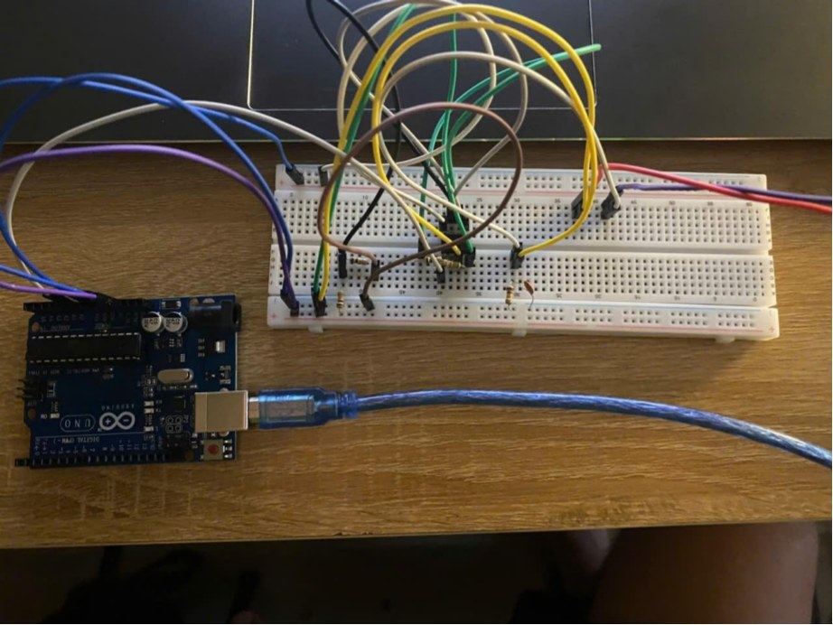
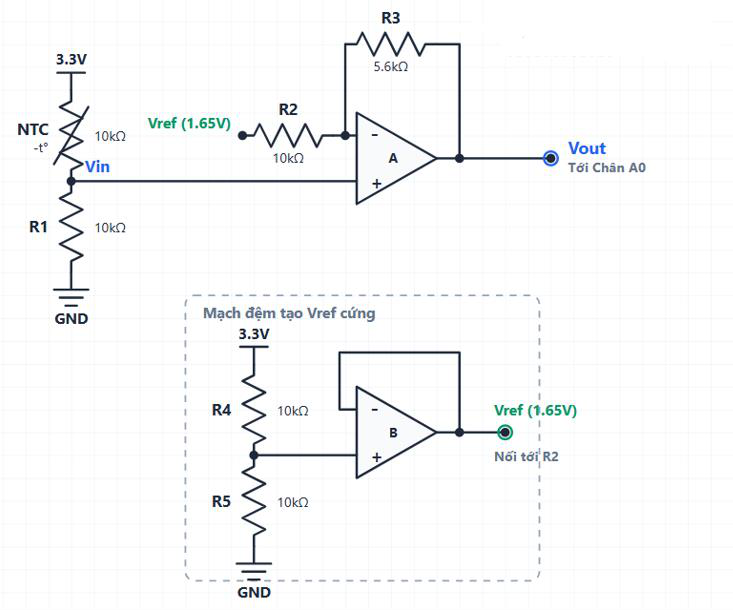
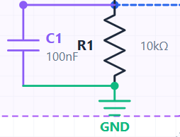
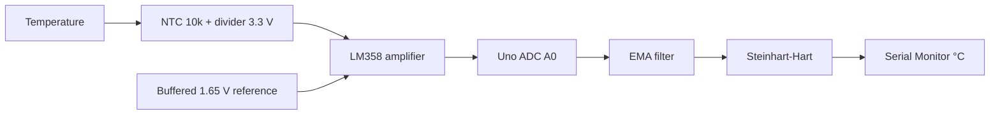

# NTC Temperature Monitoring — Arduino Uno + LM358

[](https://github.com/tranduclong24102005-dot/NTC-Temperature-Monitoring-Arduino-LM358/actions/workflows/arduino-compile.yml)

**Temperature sensor · Signal conditioning · Arduino · Calibration**

[Tiếng Việt — full guide](README.md) · [Wiring & pinout (VI)](hardware/WIRING.vi.md) · [Firmware](firmware/ntc_temperature_monitor/ntc_temperature_monitor.ino) · [Original report (VI)](report/Cam-bien-original.pdf)

A learning-oriented temperature measurement project using an **NTC 10 kΩ / β=3950 thermistor**, a voltage divider, **LM358** analog signal conditioning, the **10-bit ADC on Arduino Uno R3**, an **exponential moving average (EMA)** filter and the **Steinhart–Hart equation**.



## Circuit Schematics

The following circuit diagrams are extracted from the original academic project report. They illustrate the NTC temperature measurement circuit, LM358 signal conditioning, and RC low-pass filter.

### 1. NTC Temperature Measurement Circuit with LM358



*Figure 1. NTC 10k thermistor, LM358 operational amplifiers, voltage reference (1.65 V), and Arduino analog input A0. Source: Page 5 of the original project report.*

### 2. RC Low-Pass Filter



*Figure 2. RC low-pass filter using a 100 nF capacitor connected between Vin and GND. Source: Page 9 of the original project report.*

> **Technical Note:** These diagrams are reproduced from the original academic report. The circuit connections, power supply voltages, LM358 output limitations, and Arduino ADC reference should be verified before hardware implementation.

For detailed calculations and circuit design explanations, refer to the [original project report](report/Cam-bien-original.pdf) and the [wiring guide](hardware/WIRING.vi.md).


## What you'll learn

- Build an NTC voltage divider (3.3 V supply) with a 100 nF capacitor at VIN.
- Use the two halves of an LM358 for a buffered ~1.65 V reference and a non-inverting amplifier with level adjustment.
- Read the resulting voltage on Arduino Uno pin A0 (default ADC reference: AVcc, nominally ~5 V).
- Convert ADC → output voltage → divider voltage → NTC resistance → temperature.
- Smooth measurements with EMA and perform 3-point Steinhart–Hart calibration.
- Understand why theoretical accuracy, three measured comparison points, and a verified full operating range are different claims.



## Quick setup

1. Follow the **pin-by-pin wiring table** in [`hardware/WIRING.vi.md`](hardware/WIRING.vi.md). Use **5 V on LM358 pin 8**, **GND on pin 4**, and **3.3 V only for the NTC divider and reference divider**. Verify power rails with a multimeter before connecting the analog output to A0.
2. Open [`firmware/ntc_temperature_monitor/ntc_temperature_monitor.ino`](firmware/ntc_temperature_monitor/ntc_temperature_monitor.ino) in **Arduino IDE**.
3. Select **Arduino Uno**, the correct port, then **Verify** and **Upload**.
4. Open **Serial Monitor** at **9600 baud**. Readings update every **500 ms**.
5. For better accuracy, measure actual `ADC_REFERENCE_V` and `VREF_V` and perform sensor calibration.

Optional command-line compile:

```bash
arduino-cli core update-index
arduino-cli core install arduino:avr
arduino-cli compile --fqbn arduino:avr:uno firmware/ntc_temperature_monitor
```

## Reported comparison (not independently reproduced)

| Reference LM35 (°C) | NTC (°C) | Difference (°C) |
|---:|---:|---:|
| 8.4 | 8.6 | +0.2 |
| 29.8 | 29.7 | -0.1 |
| 51.3 | 51.0 | -0.3 |

The original report contains these three readings. The largest absolute difference **at those three points** is 0.3 °C; this is **not a guaranteed full-range accuracy specification**.

## Reproducibility and limitations

- The firmware was **reconstructed from code in the 20-page original project report**, with a syntax fix and numerical validity checks. It has not been independently verified on the original physical build.
- The original schematic does not specify the LM358 supply pins. Our pin table documents a technically plausible 5 V LM358 / 3.3 V divider implementation that **must be checked on hardware**.
- **LM358 is not rail-to-rail**. The theoretical upper output near 3.2 V may clip with some supply/load/IC conditions.
- The reported calibration constants are approximate matches to the three calibration points, not a mathematically exact 3-point fit.
- The analog 318 Hz RC cutoff does not by itself guarantee anti-aliasing for a 2 Hz measurement loop.

See [the technical review notes](docs/REVIEW_NOTES.vi.md) and the [calibration instructions](docs/CALIBRATION.vi.md). The accompanying PDF is preserved as historical material and may contain third-party images; the [MIT license](LICENSE) covers **new source code and original repository documentation**, not automatically all contents of the report.

 **Project status:** The original hardware prototype was built and experimentally evaluated.


## Author

**Tran Duc Long** — Project Lead & Primary Author

- **GitHub:** [@tranduclong24102005-dot](https://github.com/tranduclong24102005-dot)
- **Project:** NTC Temperature Monitoring using Arduino Uno & LM358
- **Category:** Academic Project | Embedded Systems | Electronics

This project is shared as an educational reference to help students understand temperature sensing, analog signal conditioning, Arduino programming, and sensor calibration.
