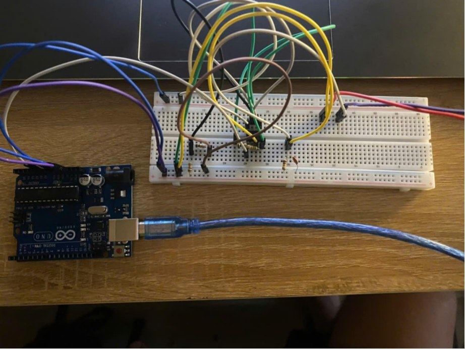
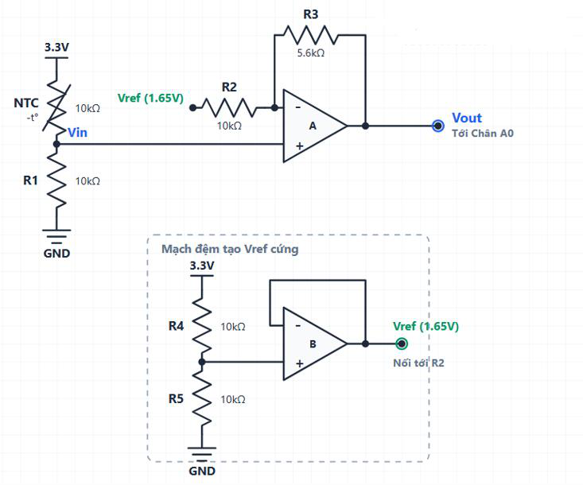
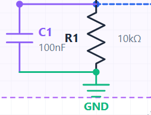
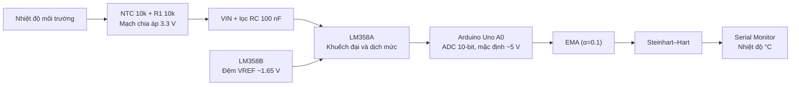

# NTC Temperature Monitoring with LM358 & Arduino Uno

[](https://github.com/tranduclong24102005-dot/NTC-Temperature-Monitoring-Arduino-LM358/actions/workflows/arduino-compile.yml)

**Dự án môn học | Temperature sensor · Signal conditioning · Arduino · Calibration**

[**Tiếng Việt**](README.md) · [**English**](README.en.md) · [Hướng dẫn lắp mạch](hardware/WIRING.vi.md) · [Mã nguồn Arduino](firmware/ntc_temperature_monitor/ntc_temperature_monitor.ino) · [Báo cáo gốc](report/Cam-bien-original.pdf)



## Sơ đồ nguyên lý mạch điện

### 1. Mạch đo nhiệt độ NTC và LM358



*Sơ đồ nguyên lý trích từ trang 5 của báo cáo gốc.*

### 2. Bộ lọc thông thấp RC



*Tụ C1 = 100 nF mắc giữa Vin và GND, theo trang 9 của báo cáo.*

> Lưu ý: Đây là sơ đồ theo báo cáo học thuật.
> Các thông số và kết nối cần được kiểm tra trước khi tái dựng phần cứng.

> [!NOTE]
> Đây là bản chia sẻ lại dự án học phần dựa trên báo cáo gốc 20 trang. Firmware trong repo được **biên soạn lại** từ mã được in trong báo cáo, bổ sung kiểm tra dữ liệu và giải thích. Các thử nghiệm số học có thể chạy trên máy tính; **chưa có xác nhận độc lập rằng bản firmware biên soạn lại đã được chạy trên phần cứng thật**. Kết quả thực nghiệm dưới đây là số liệu được ghi trong báo cáo, không phải phép đo mới.

## 1. Dự án giải quyết bài toán gì?

Cảm biến nhiệt điện trở **NTC 10 kΩ, β ≈ 3950 K** thay đổi điện trở theo nhiệt độ, nhưng Arduino chỉ đo được điện áp. Dự án sử dụng **mạch chia áp + LM358** để biến đổi tín hiệu, sau đó dùng ADC 10-bit của **Arduino Uno R3** và thuật toán để tính nhiệt độ (°C).

Dự án dành cho người muốn học từ đầu: lắp mạch trên breadboard, đo và kiểm tra từng điện áp, hiểu phép biến đổi ADC, lọc EMA, mô hình Steinhart–Hart và hiệu chuẩn bằng điểm đo thực tế.



*Đây là sơ đồ **luồng chức năng**, không thay thế sơ đồ đấu dây. Đọc [bảng nối từng chân](hardware/WIRING.vi.md) trước khi cấp nguồn.*

## 2. Linh kiện

| Thành phần | Giá trị/mẫu | Chức năng |
|---|---|---|
| Vi điều khiển | Arduino Uno R3 | Đọc A0, tính nhiệt độ, Serial |
| Nhiệt điện trở | NTC MF58 10 kΩ, β ≈ 3950 | Cảm biến |
| Op-amp | LM358 DIP-8 | 2 kênh: khuếch đại và đệm VREF |
| R1, R2, R4, R5 | 10 kΩ | Chia áp, phản hồi, VREF |
| R3 | 5.6 kΩ | Hệ số khuếch đại |
| C1 | 100 nF | Lọc RC tại VIN |
| C2 (khuyến nghị bổ sung) | 100 nF | Bypass nguồn LM358 |
| Khác | Breadboard, dây nối, cáp USB, đồng hồ đo điện | Lắp và kiểm tra |

Xem danh sách đầy đủ: [`hardware/BOM.csv`](hardware/BOM.csv).

## 3. Làm theo từ đầu (quick start)

1. **Đọc [WIRING.vi.md](hardware/WIRING.vi.md)**, nối nguồn **5 V cho LM358**, **3.3 V cho mạch NTC và bộ tạo VREF**, chung GND. Đừng nối khi Arduino còn cấp điện.
2. Dùng đồng hồ đo kiểm tra **pin 8 LM358 ≈ 5 V**, **pin 7 ≈ 1.65 V**, **VIN ≈ 1.65 V** khi NTC gần 25 °C. Cẩn thận với giới hạn ngõ ra LM358: điện áp tối đa thực tế phụ thuộc nguồn, tải và phiên bản chip.
3. Cài [Arduino IDE](https://www.arduino.cc/en/software), kết nối Uno R3 bằng USB. Mở file [`firmware/ntc_temperature_monitor/ntc_temperature_monitor.ino`](firmware/ntc_temperature_monitor/ntc_temperature_monitor.ino).
4. Chọn **Tools → Board → Arduino Uno**, chọn **Port** đúng, bấm **Verify** rồi **Upload**.
5. Mở **Serial Monitor** ở **9600 baud**. Tín hiệu cập nhật mỗi **500 ms**.
6. Đọc phần [hiệu chuẩn](docs/CALIBRATION.vi.md) trước khi tin kết quả đến 0.1 °C. Giá trị `ADC_REFERENCE_V = 5.0` và `VREF_V = 1.65` là **danh định**; để đo chính xác hơn, phải kiểm tra điện áp thực.

### Biên dịch bằng Arduino CLI (không bắt buộc)

```bash
arduino-cli core update-index
arduino-cli core install arduino:avr
arduino-cli compile --fqbn arduino:avr:uno firmware/ntc_temperature_monitor
```

Repo có GitHub Actions để thử biên dịch cho Arduino Uno khi có push/PR. Workflow **không chứng minh phần cứng hoạt động đúng**.

## 4. Thông số và kết quả trong báo cáo

| Nội dung | Thiết lập / mô tả |
|---|---|
| Đầu vào chia áp | 3.3 V |
| Tham chiếu tạo bởi LM358B | 1.65 V danh định |
| Điện áp tham chiếu ADC Uno mặc định | AVcc, khoảng 5 V khi cấp nguồn 5 V |
| ADC | 10 bit (0–1023) |
| Mạch LM358A | G = 1 + 5.6k / 10k = **1.56** |
| Lọc analog | R_th ≈ 5 kΩ tại 25 °C, C1=100 nF; fc ≈ 318 Hz |
| Lọc digital | EMA, α = 0.1 |
| Chuyển đổi nhiệt độ | Steinhart–Hart với A, B, C từ báo cáo |
| Khoảng nhiệt độ thiết kế đề xuất trong báo cáo | −3.35 °C đến 60 °C (lý thuyết, chưa được xác thực toàn dải) |

**Ba điểm đối chứng được ghi lại trong báo cáo (không phải phép đo mới):**

| LM35 (°C) | NTC (°C) | NTC − LM35 (°C) |
|---:|---:|---:|
| 8.4 | 8.6 | +0.2 |
| 29.8 | 29.7 | −0.1 |
| 51.3 | 51.0 | −0.3 |

Sai lệch tuyệt đối lớn nhất tại **ba điểm** trên là **0.3 °C**; **không đồng nghĩa độ chính xác ±0.3 °C được bảo đảm trên toàn dải**. Xem [kết quả và giới hạn](docs/EXPERIMENTS.vi.md).

## 5. Tài liệu học tập trong repo

| Bắt đầu từ | Tài liệu | Nội dung |
|---|---|---|
| Người mới | [Hướng dẫn đấu dây](hardware/WIRING.vi.md) | Bảng nối pin LM358 DIP-8, kiểm tra từng điện áp |
| Muốn hiểu nguyên lý | [Nguyên lý & công thức](docs/THEORY.vi.md) | NTC, op-amp, ADC, EMA, Steinhart–Hart |
| Muốn làm chính xác hơn | [Hiệu chuẩn](docs/CALIBRATION.vi.md) | 3 điểm chuẩn, cách tính A/B/C bằng Python |
| Muốn tái lập phép đo | [Kết quả & thí nghiệm](docs/EXPERIMENTS.vi.md) | Bảng kết quả gốc và mẫu ghi số liệu |
| Đang gặp lỗi | [Troubleshooting](docs/TROUBLESHOOTING.vi.md) | Sai dây, NaN, VREF, Serial |
| Đọc báo cáo cũ | [Đối chiếu / điểm cần xác minh](docs/REVIEW_NOTES.vi.md) | Những công thức, giới hạn cần làm rõ |
| Muốn góp ý | [CONTRIBUTING.md](CONTRIBUTING.md) | Cách phản hồi hoặc cải tiến |

Kiểm tra các phép tính độc lập (chỉ cần Python 3, không cần cài thư viện):

```bash
python scripts/verify_math.py
python scripts/calibrate_steinhart_hart.py data/calibration_points_from_report.csv
```

## 6. Giới hạn và lưu ý quan trọng

- Sơ đồ trong báo cáo **không ghi rõ chân cấp nguồn LM358**. Bảng đấu nối trong repo là phương án diễn giải phần cứng phù hợp với các mức điện áp đã nêu; cần đối chiếu với mạch thật trước khi công bố là mạch đã được tái lập thành công.
- **LM358 không phải rail-to-rail**. Khi cấp nguồn 5 V, mức ra cao gần 3.2 V phải được **đo xác nhận** vì có thể xảy ra clipping. Không cấp LM358 bằng 3.3 V rồi mặc định nó ra được 3.2 V.
- Nguồn tham chiếu ADC Uno mặc định gần **5 V**, khác nguồn chia áp **3.3 V**. Mức 3.3 V của tín hiệu **không phải** dải tham chiếu ADC mặc định.
- Bộ RC có tần số cắt ≈ 318 Hz **không đủ chứng minh chống aliasing** ở tốc độ đọc hiển thị 2 Hz.
- Các hệ số A/B/C được giữ theo báo cáo để tham khảo, **không tự động phù hợp mọi NTC**. Phần mềm báo *outside calibration points* khi ước lượng ra ngoài khoảng 8–52 °C.

Đọc [REVIEW_NOTES.vi.md](docs/REVIEW_NOTES.vi.md) nếu cần dùng dự án làm tài liệu học thuật.

## 7. Nguồn và giấy phép

- Tài liệu ban đầu: [`report/Cam-bien-original.pdf`](report/Cam-bien-original.pdf), 20 trang; giữ nguyên để đối chiếu số liệu. Một số hình linh kiện trong tài liệu có thể thuộc quyền bên thứ ba và cần kiểm tra trước khi phát hành công khai.
- [Arduino Uno R3 / Arduino IDE](https://docs.arduino.cc/hardware/uno-rev3/)
- [LM358 – Texas Instruments](https://www.ti.com/product/LM358)
- Mã firmware và tài liệu hướng dẫn mới trong repository: [MIT License](LICENSE). **Báo cáo gốc và ảnh không đương nhiên thuộc phạm vi giấy phép MIT**. Xem [CONTENT_NOTICE.md](CONTENT_NOTICE.md).

**Trạng thái:** `educational reconstruction` · `math checks included` · `hardware verification pending`.

Nếu dự án hữu ích, bạn có thể **Star**, mở **Issue** báo lỗi hoặc gửi **Pull Request** cải tiến.


## 8. Tác giả / Author

**Trần Đức Long (Tran Duc Long)** — Project Lead & Primary Author

- **GitHub:** [@tranduclong24102005-dot](https://github.com/tranduclong24102005-dot)
- **Project:** NTC Temperature Monitoring using Arduino Uno & LM358
- **Category:** Academic Project | Embedded Systems | Electronics

This repository documents my academic project, covering circuit design, Arduino firmware, signal processing, sensor calibration, and experimental evaluation. It is shared to help students and electronics enthusiasts study and reproduce the system.

**Acknowledgments:** Other contributors and external references are credited where applicable.
  

