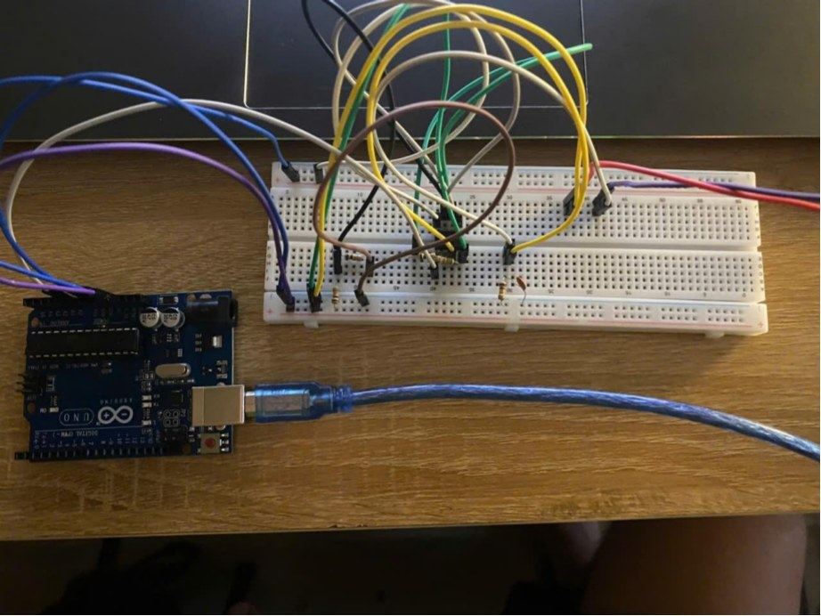
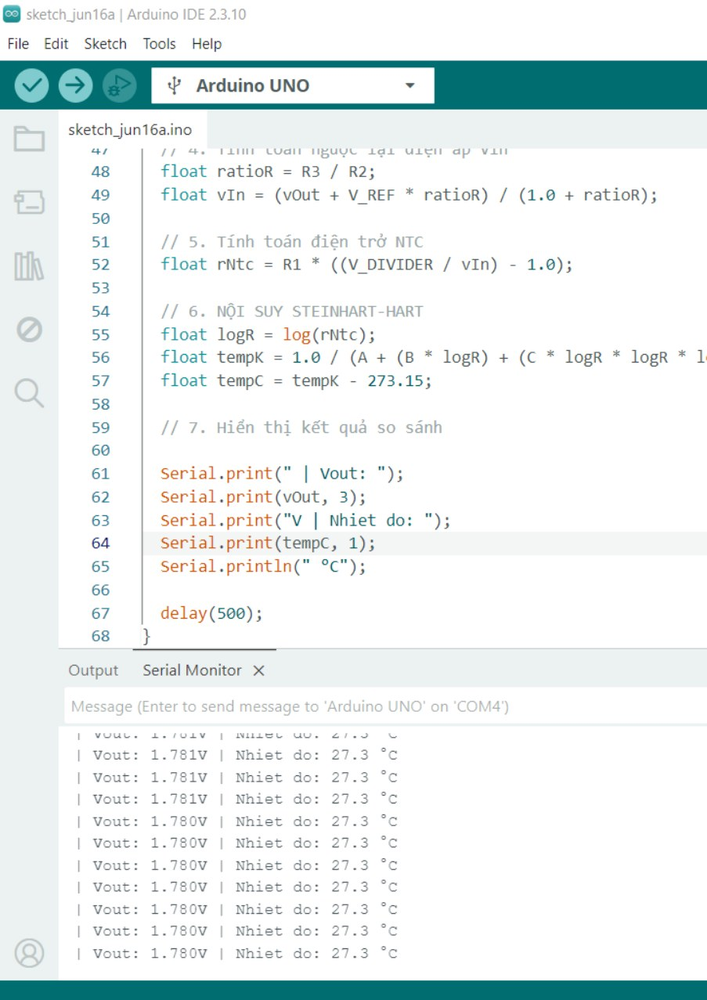

# Kết quả thực nghiệm và cách tự tái lập

## 1. Ảnh hệ thống

Ảnh mạch breadboard được trích từ **trang 14 của báo cáo gốc**:

Ảnh dùng để nhận diện bố cục, **không đủ độ rõ để suy ra từng dây nối**. Hãy dùng [WIRING.vi.md](../hardware/WIRING.vi.md) và đối chiếu với phần cứng của mình.

Ảnh màn hình Arduino IDE và Serial Monitor tại trang 16 của báo cáo (một thời điểm hiển thị khoảng 27.3°C):

## 2. Kết quả ghi trong báo cáo (nguồn gốc: trang 17)

| LM35 tham chiếu (°C) | Hệ thống NTC (°C) | NTC – LM35 (°C) | Sai lệch tuyệt đối (°C) |
|---:|---:|---:|---:|
| 8.4 | 8.6 | +0.2 | 0.2 |
| 29.8 | 29.7 | −0.1 | 0.1 |
| 51.3 | 51.0 | −0.3 | 0.3 |

Đối với đúng **ba điểm trong bảng**, MAE = **0.2°C** và sai lệch tuyệt đối tối đa = **0.3°C**. Đây là kết quả **được báo cáo**; không phải phép đo lại, và độ tin cậy còn phụ thuộc cách hiệu chuẩn và chất lượng cảm biến LM35.

Dữ liệu dạng CSV: [`data/comparison_from_report.csv`](../data/comparison_from_report.csv).

## 3. Thử nghiệm biến thiên nhiệt độ trong báo cáo

Trang 19–20 ghi chuyển từ **7°C lên 60°C**, với **thời gian xác lập được ghi nhận là 20 giây**. Áp dụng giả định hệ bậc nhất `t_s ≈ 5τ`, tác giả suy ra `τ ≈ 4s`.

Đây là một **ước lượng dựa trên giả định** về tiêu chí xác lập, không đồng nghĩa hằng số thời gian nội tại của NTC đã được đo trực tiếp. Giá trị bị ảnh hưởng bởi môi trường truyền nhiệt, LM358, tốc độ lấy mẫu và bộ lọc EMA. Muốn chứng minh τ, hãy xuất chuỗi dữ liệu nhiệt độ theo thời gian và fit hàm mũ.

## 4. Quy trình tự kiểm chứng

1. Kiểm tra và chụp các điện áp **5V, 3.3V, VMID, VREF, VIN, VOUT** khi nhiệt độ ổn định.
2. Chọn 3 điểm để hiệu chuẩn, ghi nhiệt độ chuẩn và điện trở, tính A/B/C theo tài liệu hiệu chuẩn.
3. Chọn **ít nhất 3 điểm mới** không dùng để fit (ví dụ ở khoảng giữa và hai phía), chờ cảm biến ổn định.
4. Ở mỗi điểm, ghi `T_ref`, `T_NTC`, độ lệch, nhiệt độ môi trường, thời gian chờ và thiết bị đối chứng.
5. Thử thay đổi nhiệt độ đột ngột; lưu `time_ms`, `adc`, `vout`, `temperature_c` tại chu kỳ lấy mẫu không đổi.
6. Nếu VOUT có biểu hiện chạm trần, cần đánh giá giới hạn LM358 trước khi kết luận sai số thấp.
7. Đăng ảnh lắp thật của bản tái hiện và bảng đo mới trong Pull Request/Issue, phân biệt rõ với dữ liệu gốc.

## 5. Trạng thái xác minh

- [x] Báo cáo gốc có ảnh nguyên mẫu, mã được in và 3 điểm so sánh.
- [x] Có script kiểm tra mô hình số học độc lập với Arduino.
- [ ] Chạy firmware biên soạn lại trên đúng phần cứng trong sơ đồ đấu dây.
- [ ] Ghi điện áp VREF/AVcc thực, độ swing ra của LM358 và biên độ nhiễu.
- [ ] Công bố log đo nguyên thủy đa điểm và thông số cảm biến đối chứng.

Chỉ đánh dấu các mục còn trống khi thực sự đo lại.
